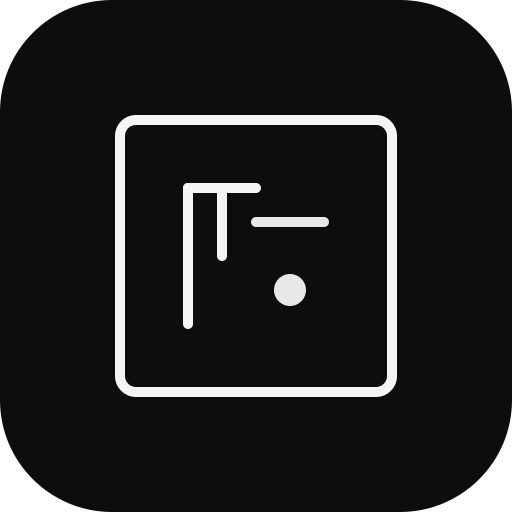

  

<h1 align="center">Yomika</h1>

面向 LANraragi 与 E-Hentai 的本地优先阅读与档案管理客户端。

Yomika 把一台（或多台）LANraragi 服务器上的档案整理成顺手可读的本地书架：库索引、封面、阅读页与设置都存在自己机器上，断网也能翻已经看过的内容；多设备之间用 WebDAV 或 S3 兼容对象存储（Cloudflare R2、MinIO 等）同步阅读进度、历史与书架（待看），端到端加密。它不包含 LANraragi 服务端，也不替代 E-Hentai 站点——你仍然需要自备一台 LANraragi 和（可选的）E-Hentai 账户。

## 首次使用

1. **连上服务器** — 设置 → 通用 → 服务器，填 LANraragi 地址与 API Key（在 LANraragi 的「设置 → 安全」里生成）。可以配多台，同时只启用一台，其余随时一键切换。
2. **让档案库就绪** — 打开档案库会拉取一次索引与封面，之后即使服务器暂时不可达，列表仍按上次的快照显示。
3. **开始阅读** — 点卡片进入阅读器；进度会自动记录，历史、首页的「继续阅读」与档案卡片上的进度都据此更新。
4. **（可选）登录 E-Hentai** — 设置 → E-Hentai，用 Cookie 登录后可看评论、收藏、把「我的标签」优先显示，并让删除档案时顺带清理对应的收藏。
5. **（可选）多设备同步** — 设置 → 同步，添加同步账户后即可同步：类型选 WebDAV 目录，或 S3 兼容对象存储（Cloudflare R2 等，填端点、存储桶与 Access Key）。默认带上阅读进度、历史、待看、搜索预设与非重复标记；LRR 服务器、E-Hentai 账户与应用设置带地址和账号名，要在账户里单独勾选才会同步。
6. **出问题看这里** — 关于 → 错误日志：本次运行记录到的失败都在里面，可一键导出。

## 功能

### 首页与档案库

- **首页书架** — 继续阅读、待看档案、随机漫游三排。可以隐藏已读完的条目（继续阅读按 95% 进度判断，随机漫游会继续抽到填满一整排），也可以把启动页直接设成档案库。
- **搜索与筛选** — 关键词搜索走 LANraragi 的检索语法；分类筛选含「无标签」；排序字段与方向随时切换；常用搜索可以存成**检索预设**，下次一键取回。
- **两种卡片** — 宽行卡（信息多，带时间线）与缩略卡（一屏看更多）；卡片上直接显示页数、体积、时间与标签（标签来自 EhTagTranslation 的社区翻译）。
- **大库也顺** — 列表按行虚拟化，几万条的库照样顺滑滚动；到底自动加载下一页，也支持触底回弹下拉刷新。
- **详情面板** — 封面、页数、体积、时间、按命名空间分组的标签（点标签即搜索）、简介与操作按钮。按钮显示哪几个可以在设置里挑，其余收在右上角菜单；元数据（标题、标签、简介）可直接编辑回写服务器。
- **右键与多选** — 右键任意卡片得到完整菜单（阅读 / 待看 / 收藏 / 下载 / 编辑 / 删除）；多选后可批量加入待看、加入收藏夹或删除。

### 阅读器

- **版式** — 自动、单页、双页、连续滚动四种，阅读中一键循环；阅读方向支持从左到右与从右到左（日漫）。
- **翻页** — 键盘 `←` `→`、`PageUp` `PageDown`、空格翻页，`Esc` 收起工具栏；鼠标拖拽与触屏滑动都可翻页，双指缩放与拖动查看局部。
- **缩略面板** — 兼作档案概览：封面、页数体积、按命名空间分组的标签，以及整本页的缩略网格，点哪页跳哪页。
- **阅读体验** — 可选提前预取若干页（默认 2），翻页几乎无等待；超分与去码可以在阅读中临时开关，原图先显示、处理结果就绪后原地替换；隐身模式阅读不写入任何进度。
- **进度与恢复** — 页序、版式与方向都会记住，下次打开回到离开的那一页；历史页按天分组显示阅读轨迹。

### 书架、收藏与待看

- **历史** — 读过的档案按时间线排列，可批量移出。
- **收藏夹** — 与 LANraragi 的 🔖 Favorites 分类对应，在 Yomika 里收藏即写回服务器。
- **待看** — 「打算读」的清单，与收藏分开；读完可移出。
- 三个书架都支持多选批量操作，卡片右键菜单里也能一键进出。

### E-Hentai

- **账户** — 多账户 Cookie 登录，带健康检查与 Cookie 导出（方便在别的设备上登录）。
- **互动** — 直接看画廊评论；收藏与取消收藏会同步到 E-Hentai。
- **我的标签** — 拉取账户的「我的标签」后，这些标签在卡片与详情页优先靠左显示并带预设底色。
- **删除同步** — 删除档案时可选一并删除对应的 E-Hentai 收藏（需已登录；删除前会再确认一次，收藏删不掉时会说明原因并可重试）。

### 查重工作台

把同一本漫画的多个副本找出来并清理掉，整个流程都在本机完成：

1. **检测范围** — 按加入日期圈定范围（默认全库），点「开始扫描」。扫描比对封面与文件名两路证据，进度条显示阶段、缓存命中与下载量，可以取消、之后恢复。
2. **看结果** — 结果是**重复组**（两两成对）与**重复链**（一条关系串起多个组，单独占一整行）。可以按来源（封面相似 / 文件名）筛选，也可以只看「已选择 / 待选择」，方便复核。
3. **做选择** — 点组标题 = 整组标记为不重复；勾选组内档案 = 待删除；「智能选择」按每组留一本自动挑好（手动改过的组不会被覆盖），「全选分组」一键全选。
4. **执行所选** — 先标记、后删除；删除会弹确认，并可选同时删除 E-Hentai 收藏。个别档案失败不影响其余，失败原因会逐条说明。
5. **善后** — 误判的对会进「不重复关系」，列表里可以随时恢复；每次扫描都会存档，之后能从「扫描结果」重新载入继续处理。

不重复关系里的标题可以点开**档案概览**就地查看（封面、标签、整本页网格），不用跳到阅读器再回来。

### 上传、下载与任务

- **上传** — 把压缩包拖进窗口或批量选择，也可以粘贴下载链接，加入队列后逐个交给 LANraragi；每一项的状态与失败原因都留在列表里。
- **下载** — 从档案详情或右键菜单发起，任务中心显示进度；下载目录在设置 → 通用里指定。
- **状态栏** — 底部常驻显示连接状态、档案总数、同步状态、任务数与缓存占用。

### 图像增强

- **超分（waifu2x）与去码** — 模型在设置 → 高级里安装，内置 waifu2x-upconv7；去码模型包按需下载或从本地导入。
- **按需开启** — 阅读时点工具栏上的图标即可对本次阅读生效（没有装模型时会提示去哪里装）。
- **自动开启** — 可以设一个平均每页体积阈值，偏大的档案一进阅读就自动开超分，省得每本都手动点。

### 外观与舒适度

- **主题** — 浅色 / 深色 / 跟随系统；基础配色一键套用，高级模式可在设计令牌之后追加任意 CSS，改动即时生效。
- **SFW 模式** — 打开后所有封面（含阅读器里的缩略面板）模糊显示，悬停封面或点击卡片才临时显示那一枚，移开自动恢复。
- **移动端** — 底栏可换成悬浮胶囊样式（下滑隐藏、上滑恢复），显示哪几项也能挑；桌面端侧边栏可折叠。
- **详情页按钮** — 详情页显示哪些操作按钮由你决定。

### 同步与迁移

- **多后端同步** — WebDAV 目录与 S3 兼容对象存储（Cloudflare R2、MinIO、AWS S3…）走同一套引擎：远端每个账户只有一份加密文档（WebDAV 在 `Yomika/<账户>.json.enc`，对象存储在 `<桶>/Yomika/<账户>.json.enc`），内容是每个对象的最新版本；S3 侧请求按 AWS Signature V4 签名。默认同步阅读进度、历史、待看、搜索预设与非重复标记；LRR 服务器、E-Hentai 账户与应用设置按需勾选，API Key 与 Cookie 始终留在本机。冲突按逻辑时钟判定（同刻比内容哈希），规则确定，不会悄悄覆盖。
- **导出 / 导入** — 阅读历史与待看可导出为可迁移的 JSON，在另一台设备导入即可恢复；服务器凭据不在导出范围内。

### 诊断

- **错误日志** — 关于页里的一行：本次运行中命令失败、未捕获异常与原生崩溃现场都会脱敏记录，可查看、可导出；每次启动重新记录，不会越积越多。
- **缓存与空间** — 设置 → 高级可查看图片缓存占用（按封面 / 缩略图 / 阅读页 / 增强结果分类）并随时清理，也可设上限，超出后按最近最少使用自动清理。

> [!IMPORTANT]
> Yomika 是便携式应用，数据都在可执行文件旁的 `data/` 目录里：SQLite 数据库、图片缓存与错误日志，连同程序一起拷走就能迁移整份资料。LANraragi API Key 与 E-Hentai Cookie 只写入系统凭据库（Windows 凭据管理器），不会落进数据文件；除标签翻译文本会从 EhTagTranslation 的发布源拉取外，Yomika 不会把库内容发往任何第三方。

## 获取

Windows 便携包由 CI 产出：在仓库的 **Actions → Build Packages and Releases** 手动触发（或打 `app-v*` 标签），从产物里取到便携目录后解压即用，首次启动按上面的「首次使用」走一遍即可。

> [!NOTE]
> 目前只维护与发布 Windows 版本；macOS 与 Linux 不在维护范围内。运行需要自备 LANraragi 实例，E-Hentai 相关功能需自备账户。

## 第三方

- 标签翻译数据来自 [EhTagTranslation](https://github.com/EhTagTranslation/Database) 社区数据库，运行时从其 DatabaseReleases 发布源获取。
- 内置的 waifu2x-upconv7 模型源自 nihui/waifu2x-ncnn-vulkan（MIT，许可文本随模型安装到数据目录）；Anime4K 着色器取自 bloc97/Anime4K（MIT，文件头随资源保留）。
- 去码模型包（Aletheia-Lens，GPL-3.0）不内嵌于应用，以独立 Release 分发并随包附带其许可证文本。
- JHenTai（Apache-2.0）、LANreader（MIT）、ComicReadScript（AGPL-3.0）、imsearch（GPL-3.0）等仅作为本地行为参考，未复制源码、资源或文案。

## 许可证

Yomika 以 [MIT 许可证](LICENSE)发布，版权归 Yomika contributors 所有。上面「第三方」里列出的模型、着色器与社区数据各有自己的许可，随对应资源一并生效。
